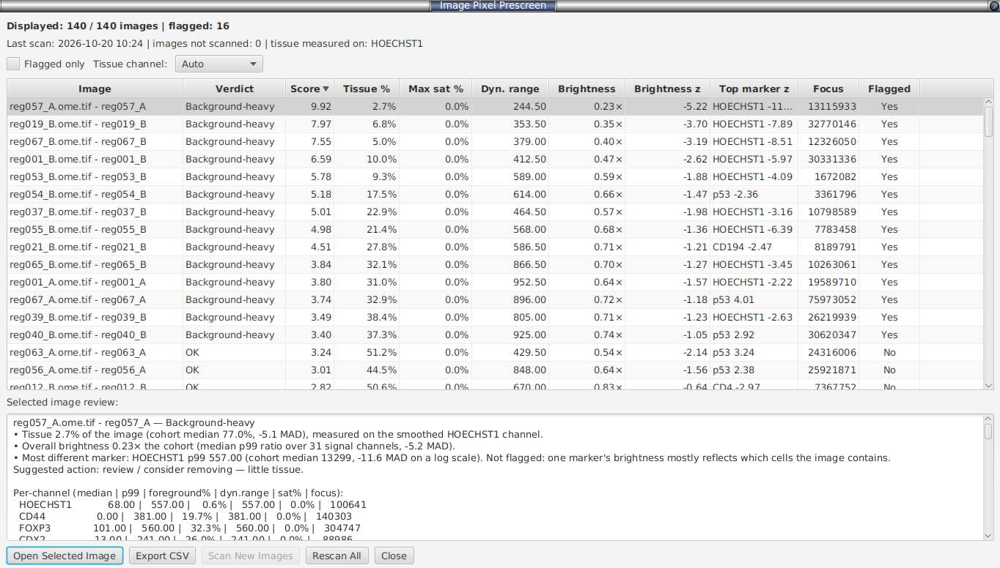
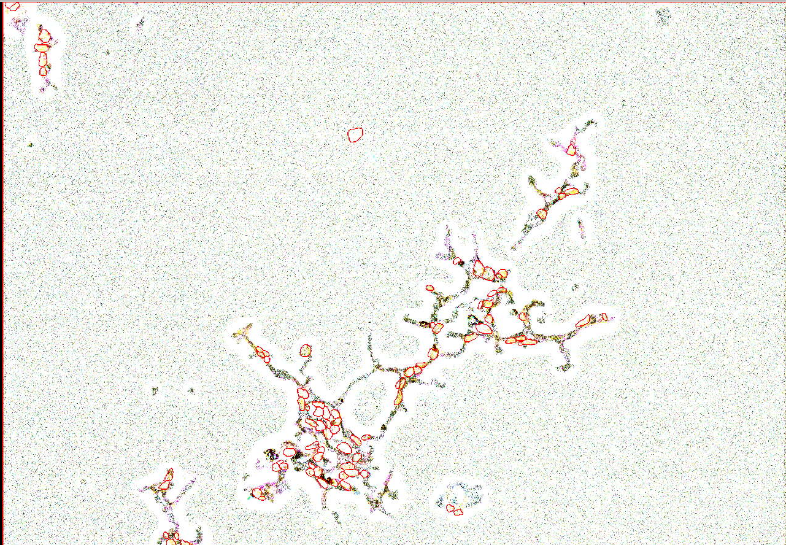

# Image pixel prescreen (whole-image QC, no cells needed)

> **Experimental.**

**Menu:** *Extensions → SP Classify → Image Pixel Prescreen...*

Run this at the start of a project, before segmentation. It reads a low-resolution copy of every image, measures pixel intensities for each channel, and flags images that differ from the rest of the project: mostly background, saturated, weakly stained, or unusually bright or dim. Use it to decide which images to fix, exclude, or label more heavily later. It does not need cells. The [Project Prediction Summary](prediction-summary.md) does a similar check after classification.

### How it works

1. Each image is read at the pyramid level closest to 2048 px on its long edge, so every image is compared at the same size. Up to 4 images are read at once. Only the pixels are read; the image's objects (cells, annotations) are not loaded. **Cancel** in the progress window stops the scan after the images already being read; those results are kept.
2. Channels are matched across images by name.
3. Statistics are calculated for each channel (table below), including a sharpness measure (**focus**). For each nuclear channel (name contains DAPI, Hoechst, DRAQ5, DRAQ7, SYTO, NucBlue, SiR-DNA, SPY-DNA, RedDot, nuclear, nuclei or nucleus; at most 4 per image) a tissue profile is also stored (see **tissue fraction** below).
4. Image-level values are compared across the project as robust z-scores: `0.6745 × (value − project median) / MAD`. This is the same method as §8.
5. Fixed threshold rules give each image a **verdict**, zero or more **flags**, and a written **review**.

### What each statistic means

Per channel, over all pixels of the low-resolution image:

| Statistic | What it tells you |
|---|---|
| **median** | Middle pixel value. Single bright pixels do not change it. |
| **mean** | Average pixel value. Single very bright pixels raise it. |
| **std** | Standard deviation: the spread of pixel values. |
| **min / max** | Lowest and highest pixel value. `max` is shown but not used for flags, because one bright pixel sets it. |
| **p1 / p99** | 1st and 99th percentiles. `p1` is the background level and `p99` the signal level. Single extreme pixels do not change them. |
| **saturation fraction** | Fraction of pixels at or above 99.9% of the highest value the file can store (255 for 8-bit, 65535 for 16-bit). Measures clipping (over-exposure). `n/a` for floating-point images. |
| **Otsu threshold** | Automatic cut-off between background and foreground (Otsu's method). The histogram spans the 0.1th to 99.9th percentile, so a few very bright pixels do not move it. Empty for a channel where every pixel has the same value. |
| **background fraction** | Fraction of pixels below the Otsu threshold (1 for a constant channel). |
| **foreground coverage** | 1 − background fraction. Used to decide which channels have signal (see below). |
| **dynamic range** | `p99 − p1`. Close to zero for flat, weak or empty channels. |
| **Laplacian variance (focus)** | Sharpness measure (higher = sharper). It also depends on brightness, so compare it only within a project. |

Image-level:

| Statistic | What it tells you |
|---|---|
| **tissue fraction** | Fraction of the image that is tissue, measured on a nuclear channel. The channel is averaged over a 30 µm square window (1% of the long edge if the pixel size is unknown), so the area around and between nuclei counts as tissue. One threshold is fitted on all images together (Otsu's method on `log(1 + value)`), so a nearly empty image is not split at its own noise level. The channel is chosen with **Tissue channel** (default **Auto**: the nuclear channel present in most images). If no image has a nuclear channel, the fraction of pixels above the Otsu threshold in at least one channel is used instead; with many channels this is unreliable, because a channel without stain still has pixels above its own threshold. |
| **brightness** | How bright the whole image is compared with the project: for each channel with signal, the image's `p99` divided by the project median `p99`; the median of these ratios. 1.00× is typical. Sets `INTENSITY_OUTLIER`. |
| **top marker z** | The channel with signal whose `log(p99)` z-score is furthest from 0, and that z-score. Shown only; it never flags an image, because the brightness of one marker mostly depends on which cells the image contains (for example, whether a lymphoid follicle is present). |
| **focus** | The highest per-channel focus value (the sharpest channel). Shown only; it never flags an image, because it changes with brightness as well as sharpness. |

A channel **has signal** if its median foreground coverage across the project is at least 5%. Channels with almost no signal are left out of the brightness values, so they cannot produce false flags.

### Verdicts, flags, and the score

Each image gets one **verdict** and zero or more **flags**. Default thresholds (z = robust z-score):

| Verdict / flag | Set when |
|---|---|
| `BACKGROUND_HEAVY` | tissue-fraction z ≤ −2.5, **or** tissue fraction < 5% |
| `SATURATED` | highest channel saturation fraction ≥ 1% **and** its z ≥ 3.0, **or** saturation fraction ≥ 5% whatever the other images show |
| `WEAK_SIGNAL` | median dynamic-range z ≤ −2.5 |
| `INTENSITY_OUTLIER` | the z-score of `log(brightness)` is ≥ 2.5 or ≤ −2.5 (the whole image is brighter or dimmer than the project) |
| `OK` | none of the above |

When several flags are set, the verdict is the first in the order above.

The **Score** is `max(0, −tissue z)` + the saturation z (if `SATURATED`) + `max(0, −dynamic-range z)` + `max(0, |brightness z| − 2)`. A higher Score means the image is more unusual for the project. The table is sorted by Score by default.

**Table columns:** Image, Verdict, Score, Tissue %, Max sat %, Dyn. range, Brightness, Brightness z, Top marker z, Focus, Flagged. Tick **Flagged only** to hide unflagged images. The line under the summary shows the time of the last scan, the number of images without results, and the channel tissue was measured on.

The **review pane** below the table explains the result for the selected image, for example:

> image_07 — Background-heavy
> • Tissue 2.7% of the image (cohort median 77.0%, -5.1 MAD), measured on the smoothed DAPI channel.
> • Overall brightness 0.23× the cohort (median p99 ratio over 31 signal channels, -5.2 MAD).
> • Most different marker: DAPI p99 557.00 (cohort median 13299, -11.6 MAD on a log scale). Not flagged: one marker's brightness mostly reflects which cells the image contains.
> Suggested action: review / consider removing — little tissue.

This is followed by a table for each channel (median | p99 | foreground% | dyn.range | sat% | focus).

The image below is flagged **Background-heavy**: tissue covers a few small areas and the rest of the image is empty.

**Buttons:**
- **Open Selected Image** opens the image without saving the current one.
- **Scan New Images (N)** reads only the N project images that have no saved results (for example, images added after the last scan). The z-scores and flags of every image are then recalculated.
- **Rescan All** discards the saved results and reads every image again.
- **Export CSV** writes one row per image: image-level columns (`TissueFraction`, `TissueFractionZ`, `TissueSource`, `EmptyFraction`, `MeanForegroundCoverage`, saturation, dynamic range, focus, `BrightnessShift`, `BrightnessShiftZ`, `MaxMarkerZ`, `MaxMarkerChannel`), then a block of columns for each channel (including `LaplacianVariance`).
- **Close** hides the window. The results stay available (see below).

### Saved results

After each scan the per-image statistics are saved to `<project folder>/celltune/pixel-prescreen.json`, together with the **Tissue channel** choice. Opening the prescreen again, also after restarting QuPath, shows the saved results without reading the images again. Images removed from the project are left out, and renamed images are shown with their new name. Results saved by a version that calculated the statistics differently are discarded and all images are read again.

### How to read it

- **Sort by Score** (the default) and check the top rows first.
- **Background-heavy**: little tissue compared with the other images, or less than 5% tissue. Exclude the image, re-acquire it, or crop it to the tissue. Tissue with few nuclei (fat, acellular stroma) also counts as little tissue.
- **Saturated**: a channel is clipped. Fix the exposure, or leave that channel out of intensity-based analyses.
- **Weak signal**: a flat, low-contrast image. Check the staining or exposure.
- **Intensity outlier**: most channels are brighter or dimmer than in the other images. Check the staining batch and acquisition settings, or consider batch normalisation (§19). The classifier may find these images harder.
- **Top marker z** (column and review pane): one marker differs from the project. This is usually biology, not a defect; check it only if that marker matters for your analysis.
- **Focus** (column and per channel): sort on it to find blurred images. It is not a verdict; low focus often means only that the image is dim.
- **OK**: pixel statistics are within the normal range for the project.

> **Caveats.** With fewer than about 5 images, the z-scores are unreliable. Saturation is measured against the storage bit depth, so a 12-bit image stored as 16-bit is compared with 65535. Saturation is measured on the low-resolution copy, where clipped pixels are averaged with their neighbours, so it underestimates clipping. Floating-point images show saturation as `n/a`. The tissue fraction assumes fluorescence (bright nuclei on a dark background); it does not work for brightfield (H&E) images. Up to 4 images are read at once, each at about 2048 px on the long edge with all channels, so panels with many channels need more memory. This size cannot be changed in the dialog.

---
